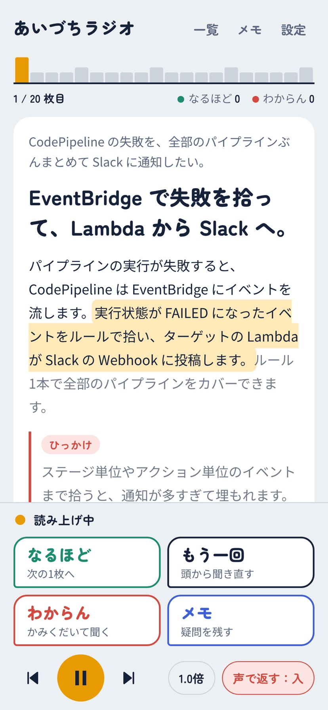
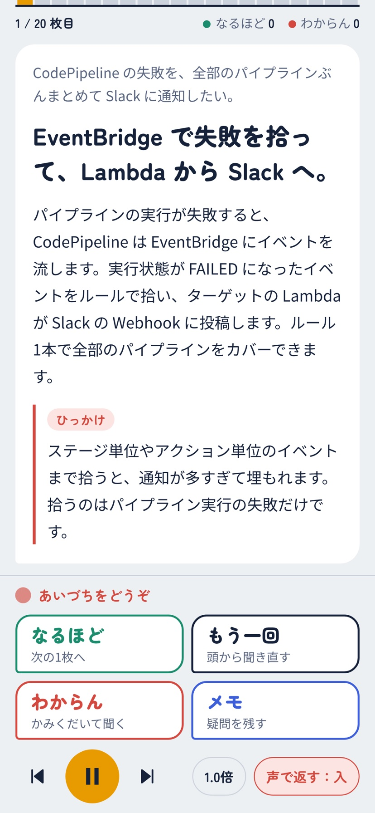
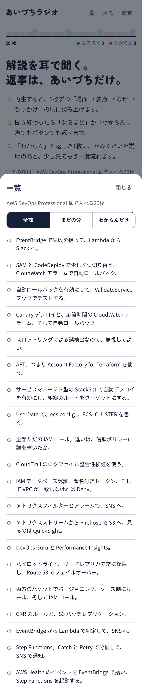
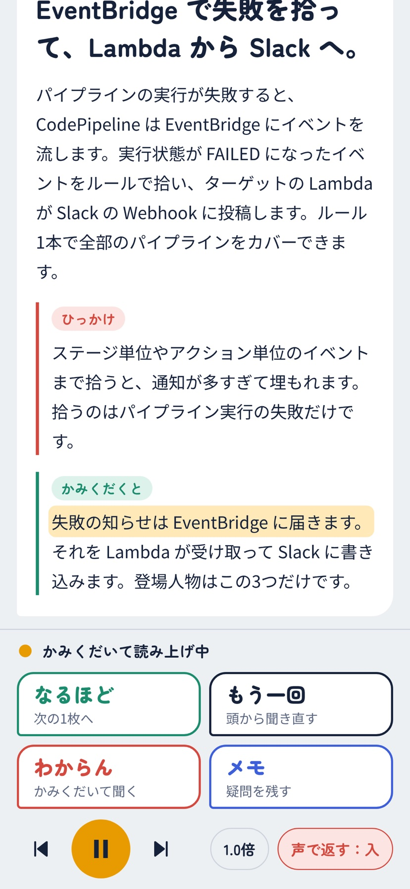
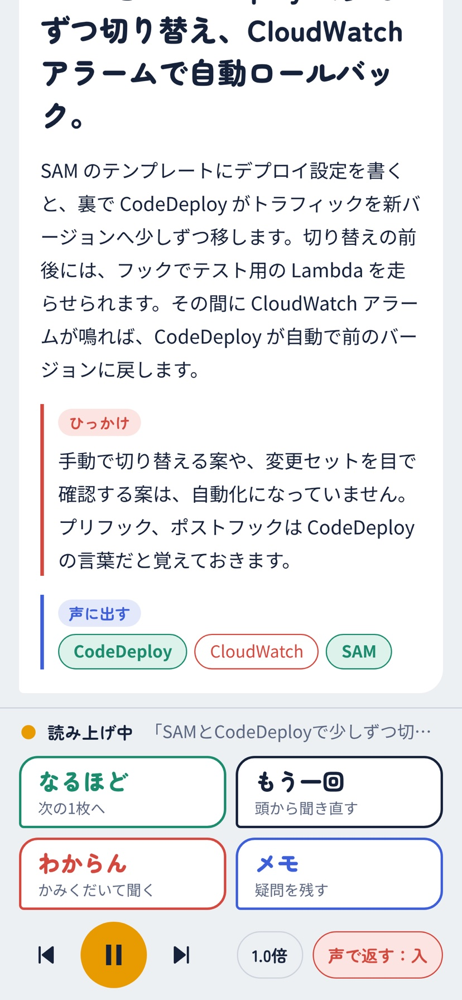
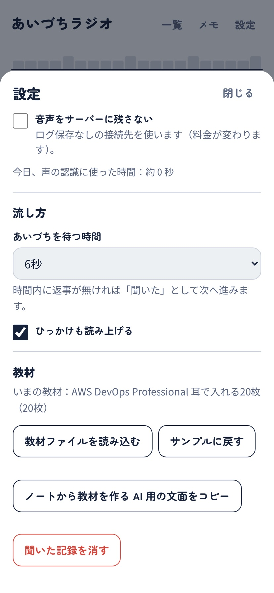
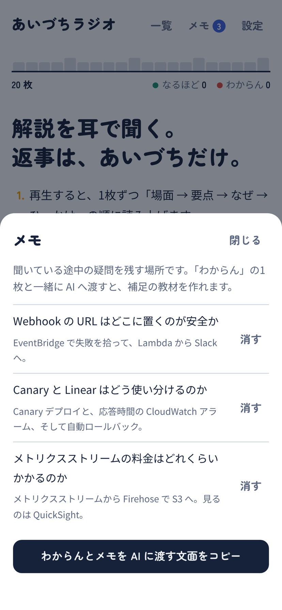

## 結論：答える勉強から、聞く勉強に作り替えた

資格勉強の教材を、電車の中で音声だけで回すアプリを作りました。
名前は「あいづちラジオ」です。

最初は「声で答えて自動採点」するドリルアプリでした。
でも、電車の中で声を出し続ける勉強は、現実的ではありませんでした。

だから発想を反転させました。
**解説を聞いて、あいづちで進む** インプット型です。

- アプリ：https://tanimoto1996.github.io/amivoice-voice-drill/
- リポジトリ：https://github.com/tanimoto1996/amivoice-voice-drill

```html-embed
<div class="c3learn">
<div class="ttl">この記事で分かること</div>
<div class="item" style="animation-delay:0s"><span class="chk">✓</span><span class="txt">「声で答えるドリル」が電車で破綻した理由</span></div>
<div class="item" style="animation-delay:.15s"><span class="chk">✓</span><span class="txt">あいづち4つで進む、インプット型の設計</span></div>
<div class="item" style="animation-delay:.3s"><span class="chk">✓</span><span class="txt">AmiVoiceの認識を「あいづち判定」に絞る工夫</span></div>
<div class="item" style="animation-delay:.45s"><span class="chk">✓</span><span class="txt">APIキーなしで生成AI（Claude）と組ませる方法</span></div>
<div class="item" style="animation-delay:.6s"><span class="chk">✓</span><span class="txt">APPKEYがなくても全機能が使える理由</span></div>
</div>
<style>
.c3learn { --acc:#3ea8ff; --bg:#eef6ff; --tx:#1a2733; --bd:#bcd9f5; border:1px solid var(--bd); border-left:4px solid var(--acc); border-radius:8px; padding:12px 16px; margin:12px 4px; font-family:-apple-system, "Hiragino Sans", "Noto Sans JP", sans-serif; background:var(--bg);}
[data-theme="dark"] .c3learn { --bg:#16324a; --tx:#e8f2fa; --bd:#33506b;}
.c3learn .ttl { color:var(--tx); font-weight:700; font-size:14px; margin-bottom:6px;}
.c3learn .item { display:flex; align-items:flex-start; gap:8px; padding:2px 0; animation:c3fade.7s ease both;}
@keyframes c3fade { from { opacity:0; transform:translateY(5px);} to { opacity:1; transform:translateY(0);}}
.c3learn .chk { flex:none; color:var(--acc); font-weight:700; font-size:13px; line-height:1.55;}
.c3learn .txt { color:var(--tx); font-size:13.5px; line-height:1.55;}
@media (prefers-reduced-motion: reduce) {.c3learn * { animation:none!important;}}
</style>
```



*読み上げ中のメイン画面。教材カードとあいづちボタン*

教材は1枚ずつ読み上げられます。
返事は「なるほど」「もう一回」「わからん」「メモ」の4つだけです。


*「あいづちをどうぞ」の状態。カード全文と「ひっかけ」が表示される*

声でもボタンでも返せます。
無言のままでも、6秒たつと「聞いた」として次へ進みます。

---

## 最初の設計：声で答えて、自動採点

もとの設計は、自分の反射ドリル（引き金→即答）を音声化するものでした。
流れはこうです。

```html-embed
<div class="c3old">
<div class="st" style="animation-delay:0s">引き金を読み上げる</div>
<div class="st" style="animation-delay:1.1s">声で答える</div>
<div class="st ng" style="animation-delay:2.2s">即答と照合して採点</div>
<div class="st" style="animation-delay:3.3s">正誤を読み上げて次へ</div>
</div>
<style>
.c3old { --tx:#1a2733; --bd:#bcd9f5; --bg:#f4f9ff; margin:12px 4px; font-family:-apple-system, "Hiragino Sans", "Noto Sans JP", sans-serif;}
[data-theme="dark"] .c3old { --tx:#e8f2fa; --bg:#12293d; --bd:#33506b;}
.c3old .st { border:1.5px solid var(--bd); background:var(--bg); color:var(--tx); border-radius:8px; padding:8px 12px; margin:6px 0; font-size:13px; font-weight:700; animation:c3pulse 4.4s ease-in-out infinite;}
.c3old .ng { border-color:#e5a3a3; background:#fff6f4;}
[data-theme="dark"] .c3old .ng { background:#2a1a16;}
@keyframes c3pulse { 0%,100% { box-shadow:0 0 0 0 rgba(62,168,255,0);} 10%,22% { box-shadow:0 0 0 3px rgba(62,168,255,.45);} 34% { box-shadow:0 0 0 0 rgba(62,168,255,0);}}
@media (prefers-reduced-motion: reduce) {.c3old * { animation:none!important;}}
</style>
```

作って、使って、すぐ分かりました。
破綻ポイントは3つです。

| 破綻ポイント | 内容 |
| --- | --- |
| 声を出す場所 | 電車で答え続けるのは無理 |
| 即答の長さ | 確認用の文章は、声で言える形ではない |
| 採点の厳しさ | 要点が合っても「不正解」になりがち |

即答はもともと「目で確認するための文章」でした。
1問ぶんを声で言い切るのは、それ自体が別の技能です。

画面の分かりにくさも指摘されました。
出題なのか、正解表示なのか、ラベルがない画面は自分でも混乱します。

正直に言うと、初版は「動くけど使えない」ものでした。
ここで設計ごと捨てることにしました。

---

## 作り替えた体験：1枚ずつ、聞いて進む

新しい設計では、教材を「カード」に分けました。
1枚ごとに、決まった4つのパートを読み上げます。

```html-embed
<div class="c3card">
<div class="st" style="animation-delay:0s"><span class="no">場面</span><span>どんな状況の問題か</span></div>
<div class="st" style="animation-delay:1.2s"><span class="no">要点</span><span>答えの核だけを短く</span></div>
<div class="st" style="animation-delay:2.4s"><span class="no">なぜ</span><span>そうなる理由</span></div>
<div class="st" style="animation-delay:3.6s"><span class="no">ひっかけ</span><span>間違えやすいポイント</span></div>
</div>
<style>
.c3card { --tx:#1a2733; --bd:#bcd9f5; --bg:#f4f9ff; --acc:#3ea8ff; margin:12px 4px; font-family:-apple-system, "Hiragino Sans", "Noto Sans JP", sans-serif;}
[data-theme="dark"] .c3card { --tx:#e8f2fa; --bg:#12293d; --bd:#33506b;}
.c3card .st { display:flex; align-items:center; gap:10px; border:1.5px solid var(--bd); background:var(--bg); color:var(--tx); border-radius:8px; padding:8px 12px; margin:6px 0; font-size:13px; animation:c3pulse2 4.8s ease-in-out infinite;}
.c3card .no { flex:none; font-weight:700; font-size:12px; color:var(--acc); width:52px;}
@keyframes c3pulse2 { 0%,100% { box-shadow:0 0 0 0 rgba(62,168,255,0);} 10%,22% { box-shadow:0 0 0 3px rgba(62,168,255,.45);} 34% { box-shadow:0 0 0 0 rgba(62,168,255,0);}}
@media (prefers-reduced-motion: reduce) {.c3card * { animation:none!important;}}
</style>
```

実物のカードはこんな形です。
サンプル教材（AWS DevOps Professional・20枚）の1枚目です。

| パート | 内容 |
| --- | --- |
| 場面 | CodePipelineの失敗を、全部のパイプラインぶんまとめてSlackに通知したい |
| 要点 | EventBridgeで失敗を拾って、LambdaからSlackへ |
| ひっかけ | ステージ単位のイベントまで拾うと、通知が多すぎて埋もれる |

記号まじりのメモ書きだった元の教材を、話し言葉に書き直しました。
耳で聞いて分かる文でないと、この形式では成立しません。

教材の全体像は、一覧で見られます。


*サンプル教材の一覧。要点だけが並ぶので、耳で聞く前に全体像もつかめる*

---

## 返事は「あいづち」4つだけ

読み上げが終わると、あいづちの待ち時間に入ります。
返事は4種類しかありません。

```html-embed
<div class="c3aiz">
<div class="card"><div class="ct">なるほど</div><div class="cb">記録して、次へ進む</div></div>
<div class="card"><div class="ct">もう一回</div><div class="cb">同じ1枚を頭から聞く</div></div>
<div class="card"><div class="ct">わからん</div><div class="cb">かみくだいた説明が流れ、3枚あとに再登場</div></div>
<div class="card"><div class="ct">メモ</div><div class="cb">続けて話した疑問を、その1枚のメモとして保存</div></div>
</div>
<style>
.c3aiz { --tx:#1a2733; display:flex; gap:8px; flex-wrap:wrap; margin:12px 4px; font-family:-apple-system, "Hiragino Sans", "Noto Sans JP", sans-serif;}
[data-theme="dark"] .c3aiz { --tx:#e8f2fa;}
.c3aiz .card { flex:1; min-width:120px; border:1.5px solid #bcd9f5; background:#eef6ff; border-radius:8px; padding:10px 12px; color:var(--tx);}
[data-theme="dark"] .c3aiz .card { background:#16324a; border-color:#33506b;}
.c3aiz .ct { font-weight:700; font-size:13.5px; margin-bottom:4px;}
.c3aiz .cb { font-size:12px; line-height:1.6;}
@media (prefers-reduced-motion: reduce) {.c3aiz * { animation:none!important;}}
</style>
```


声でもボタンでも返せます。
ここが設計の肝で、**声は「使えれば使う」位置づけ** に下げました。

降りる駅が近い、周りが混んでいる、声を出せる状況でない。
そういう場面では、無言のまま置いておけば進みます。

---

## 「わからん」は、3枚あとに戻ってくる

「わからん」と返したカードには、2つのことが起きます。
まず、その場でかみくだいた説明（easy）が流れます。

そして、そのカードは3枚あとに再登場します。
忘れた頃ではなく、少し間を空けて、です。

```html-embed
<div class="c3cycle">
<div class="ph" style="animation-delay:0s">「わからん」と返す</div>
<div class="ph" style="animation-delay:1.1s">かみくだいた説明を聞く</div>
<div class="ph" style="animation-delay:2.2s">次の3枚を進む</div>
<div class="ph" style="animation-delay:3.3s">同じカードが再登場</div>
</div>
<style>
.c3cycle { --tx:#1a2733; --bd:#bcd9f5; display:flex; gap:6px; flex-wrap:wrap; margin:12px 4px; font-family:-apple-system, "Hiragino Sans", "Noto Sans JP", sans-serif;}
[data-theme="dark"] .c3cycle { --tx:#e8f2fa; --bd:#33506b;}
.c3cycle .ph { flex:1; min-width:110px; text-align:center; font-size:12px; font-weight:700; color:var(--tx); border:1.5px solid var(--bd); border-radius:20px; padding:6px 4px; background:#fdf3e3; animation:c3ph 4.4s ease-in-out infinite;}
[data-theme="dark"] .c3cycle .ph { background:#453311;}
@keyframes c3ph { 0%,100% { box-shadow:0 0 0 0 rgba(255,176,32,0);} 10%,20% { box-shadow:0 0 0 3px rgba(255,176,32,.55);} 32% { box-shadow:0 0 0 0 rgba(255,176,32,0);}}
@media (prefers-reduced-motion: reduce) {.c3cycle * { animation:none!important;}}
</style>
```


*「わからん」と返すと、かみくだいた説明が読み上げられる*

採点はしません。
「分かったかどうか」は、本人のあいづちが申告するだけです。

ゆるい仕組みですが、電車で続けられる形を優先しました。
続かない厳密さより、続くゆるさです。

---

## 無言6秒で進む：返事できない場面を潰す

あいづちの待ち時間に何も返さなければ、6秒で「聞いた」として次へ進みます。
秒数は設定で変更できます。

```html-embed
<div class="c3sil">
<div class="seg s1"><span class="sl">読み上げ終了</span></div>
<div class="seg s2"><span class="sl">無言のまま6秒</span></div>
<div class="seg s3"><span class="sl">「聞いた」として次へ</span></div>
</div>
<style>
.c3sil { --tx:#1a2733; --bd:#bcd9f5; display:flex; gap:6px; margin:12px 4px; font-family:-apple-system, "Hiragino Sans", "Noto Sans JP", sans-serif;}
[data-theme="dark"] .c3sil { --tx:#e8f2fa; --bd:#33506b;}
.c3sil .seg { border:1.5px solid var(--bd); border-radius:8px; padding:10px 8px; color:var(--tx); text-align:center; animation:c3pulse3 4.5s ease-in-out infinite;}
.c3sil .s1 { flex:1.4; background:#eef6ff;}.c3sil .s2 { flex:2.4; background:#fdf3e3;}.c3sil .s3 { flex:1.8; background:#e9f7ee;}
[data-theme="dark"] .c3sil .s1 { background:#16324a;} [data-theme="dark"] .c3sil .s2 { background:#453311;} [data-theme="dark"] .c3sil .s3 { background:#173d27;}
.c3sil .sl { font-size:12px; font-weight:700;}
.c3sil .s1 { animation-delay:0s;}.c3sil .s2 { animation-delay:1.5s;}.c3sil .s3 { animation-delay:3s;}
@keyframes c3pulse3 { 0%,100% { box-shadow:0 0 0 0 rgba(62,168,255,0);} 10%,22% { box-shadow:0 0 0 3px rgba(62,168,255,.45);} 34% { box-shadow:0 0 0 0 rgba(62,168,255,0);}}
@media (prefers-reduced-motion: reduce) {.c3sil * { animation:none!important;}}
</style>
```

マイクを開くのは、このあいづち待ちの数秒だけです。
常時聞き耳を立てないので、電池にも気持ちにも優しい作りになりました。

---

## 任意の復唱：正誤はつけず、用語が点灯する

もう1つ、任意機能として「要点を声に出す」復唱を入れました。
言えた用語が画面で点灯するだけです。

```html-embed
<div class="c3term">
<span class="tm on">EventBridge</span>
<span class="tm on">Lambda</span>
<span class="tm">Slack</span>
<span class="tm">CodePipeline</span>
<div class="cap">正解・不正解は出ない。言えた用語だけが灯る</div>
</div>
<style>
.c3term { --tx:#1a2733; --bd:#bcd9f5; border:1.5px solid var(--bd); border-radius:8px; padding:12px 14px; margin:12px 4px; font-family:-apple-system, "Hiragino Sans", "Noto Sans JP", sans-serif; color:var(--tx); background:#fbfdff;}
[data-theme="dark"] .c3term { --tx:#e8f2fa; background:#101c28; --bd:#33506b;}
.c3term .tm { display:inline-block; font-size:13px; font-weight:700; border:1.5px solid var(--bd); border-radius:16px; padding:4px 12px; margin:3px 2px; opacity:.45;}
.c3term .tm.on { opacity:1; background:#e9f7ee; border-color:#8fd3a8; animation:c3light 2.8s ease-in-out infinite;}
[data-theme="dark"] .c3term .tm.on { background:#173d27;}
.c3term .cap { font-size:12.5px; margin-top:8px;}
@keyframes c3light { 0%,100% { box-shadow:0 0 0 0 rgba(29,158,87,0);} 50% { box-shadow:0 0 0 3px rgba(29,158,87,.35);}}
@media (prefers-reduced-motion: reduce) {.c3term * { animation:none!important;}}
</style>
```

実物の画面はこんな形です。
カードの下に用語が並び、言えたものから灯ります。


*復唱の様子。CodeDeployとSAMは点灯、CloudWatchは未点灯。正誤は出ない*

旧設計の反省がここに生きています。
アウトプットは「任意」で「採点なし」に限り、電車でも壊れません。

---

## AmiVoiceの使い方：認識は「あいづち判定」だけに絞る

音声認識には、AmiVoice Cloud Platformを使っています。
エンジンは `-a-general`、接続はWebSocketです。

設計のポイントは、認識の仕事を小さくしたことです。
自由な発話を理解するのではなく、**4つのあいづちのどれかを当てる** だけにしました。

```html-embed
<div class="c3conn">
<div class="st" style="animation-delay:0s">あいづち待ちの窓が開く</div>
<div class="st" style="animation-delay:1.1s">WebSocketで接続し、マイクを開く</div>
<div class="st" style="animation-delay:2.2s">発話を認識する</div>
<div class="st" style="animation-delay:3.3s">切断して、読み上げに戻る</div>
</div>
<style>
.c3conn { --tx:#1a2733; --bd:#bcd9f5; --bg:#f4f9ff; margin:12px 4px; font-family:-apple-system, "Hiragino Sans", "Noto Sans JP", sans-serif; }
[data-theme="dark"] .c3conn { --tx:#e8f2fa; --bg:#12293d; --bd:#33506b; }
.c3conn .st { border:1.5px solid var(--bd); background:var(--bg); color:var(--tx); border-radius:8px; padding:8px 12px; margin:6px 0; font-size:13px; font-weight:700; animation:c3pulse4 4.4s ease-in-out infinite; }
@keyframes c3pulse4 { 0%,100% { box-shadow:0 0 0 0 rgba(62,168,255,0); } 10%,22% { box-shadow:0 0 0 3px rgba(62,168,255,.45); } 34% { box-shadow:0 0 0 0 rgba(62,168,255,0); } }
@media (prefers-reduced-motion: reduce) { .c3conn * { animation:none !important; } }
</style>
```

接続は窓ごとに張って、終われば切ります。
設定で `/v1/nolog/` に切り替えることもできます。

読み上げはブラウザ標準の speechSynthesis です。
教材の用語は、読み上げではカタカナに置換して発音を安定させています。

---

## あいづち判定：spoken と辞書の照合、信頼度が低ければ聞き直す

判定は、認識結果の tokens が持つ `spoken`（読み）と、辞書を照合して行います。
表記ゆれではなく「読み」で見るので、「なるほど」のような定型の返事は安定して拾えます。

```html-embed
<div class="c3judge">
<div class="flow"><span class="fb">発話</span><span class="fa">→</span><span class="fb">tokens の spoken</span><span class="fa">→</span><span class="fb">辞書と照合</span><span class="fa">→</span><span class="fb ok">あいづち確定</span></div>
<div class="flow sub"><span class="fb ng">confidence が 0.5 未満</span><span class="fa">→</span><span class="fb">採用せず、聞き直す</span></div>
</div>
<style>
.c3judge { --tx:#1a2733; --bd:#bcd9f5; border:1.5px solid var(--bd); border-radius:8px; padding:12px 14px; margin:12px 4px; font-family:-apple-system, "Hiragino Sans", "Noto Sans JP", sans-serif; color:var(--tx); background:#fbfdff; }
[data-theme="dark"] .c3judge { --tx:#e8f2fa; background:#101c28; --bd:#33506b; }
.c3judge .flow { display:flex; align-items:center; gap:6px; flex-wrap:wrap; margin:6px 0; }
.c3judge .fb { font-size:12px; border:1px solid var(--bd); border-radius:6px; padding:4px 8px; background:#eef6ff; }
[data-theme="dark"] .c3judge .fb { background:#16324a; }
.c3judge .fb.ok { background:#e9f7ee; border-color:#8fd3a8; font-weight:700; }
[data-theme="dark"] .c3judge .fb.ok { background:#173d27; }
.c3judge .fb.ng { background:#fdecec; border-color:#e5a3a3; font-weight:700; }
[data-theme="dark"] .c3judge .fb.ng { background:#3a1d1d; }
.c3judge .fa { color:#3ea8ff; font-weight:700; animation:c3flow 1.4s linear infinite; }
@keyframes c3flow { 0%,100% { opacity:.35; } 50% { opacity:1; } }
@media (prefers-reduced-motion: reduce) { .c3judge * { animation:none !important; } }
</style>
```

発話区間の confidence が0.5未満なら、その認識は採用しません。
雑音をあいづちと誤認するより、聞き直す方が安全だからです。

なお0.5という値は仮置きです。
実利用の結果を見て調整する前提で置いています。

---

## profileWords には「今の1枚」の用語だけを送る

教材の用語（terms）は、認識の profileWords としても送っています。
ただし、送るのは教材全体ではなく、**いま流れている1枚に出てくる用語だけ** です。

```html-embed
<div class="c3pw">
<div class="col ng">
<div class="ct">教材全体の用語を送る</div>
<div class="cb">候補が多すぎて、判定がぶれやすい</div>
</div>
<div class="col ok">
<div class="ct">今の1枚の用語だけ送る</div>
<div class="cb">候補が絞られ、固有名詞が拾いやすい</div>
</div>
</div>
<style>
.c3pw { --tx:#1a2733; --bd:#bcd9f5; display:flex; gap:8px; margin:12px 4px; font-family:-apple-system, "Hiragino Sans", "Noto Sans JP", sans-serif; }
[data-theme="dark"] .c3pw { --tx:#e8f2fa; --bd:#33506b; }
.c3pw .col { flex:1; border:1.5px solid var(--bd); border-radius:8px; padding:10px 12px; color:var(--tx); }
.c3pw .ng { background:#fff6f4; } .c3pw .ok { background:#f2fbf4; }
[data-theme="dark"] .c3pw .ng { background:#2a1a16; } [data-theme="dark"] .c3pw .ok { background:#14281a; }
.c3pw .ct { font-weight:700; font-size:12.5px; margin-bottom:4px; }
.c3pw .cb { font-size:12px; line-height:1.6; }
@media (prefers-reduced-motion: reduce) { .c3pw * { animation:none !important; } }
</style>
```

AWSのサービス名のような固有名詞は、音声認識の苦手分野です。
「今この文脈で出てくる単語はこれだけ」と先に渡すことで、拾いやすくする狙いです。

:::message
APPKEYがなくても、ボタン操作で全機能が使えます。
声はあくまで任意の入り口で、アプリの成立条件にはしていません。
:::

---

## 生成AIとの連携：APIキーなし、コピペの依頼文で回す

教材づくりには、生成AI（Claude）を組み合わせました。
ただしAPI連携ではありません。

アプリの中に「依頼文」を用意し、コピーしてClaudeに貼ると、教材JSONが返ってくる方式です。
追加のAPIキーも、従量課金もありません。

```html-embed
<div class="c3gen">
<div class="st" style="animation-delay:0s">自分のノートを用意する</div>
<div class="st" style="animation-delay:1.1s">アプリの依頼文をコピーし、ノートと一緒に貼る</div>
<div class="st" style="animation-delay:2.2s">Claude が教材 JSON を返す</div>
<div class="st" style="animation-delay:3.3s">アプリに取り込んで、すぐ聞ける</div>
</div>
<style>
.c3gen { --tx:#1a2733; --bd:#bcd9f5; --bg:#f4f9ff; margin:12px 4px; font-family:-apple-system, "Hiragino Sans", "Noto Sans JP", sans-serif;}
[data-theme="dark"] .c3gen { --tx:#e8f2fa; --bg:#12293d; --bd:#33506b;}
.c3gen .st { border:1.5px solid var(--bd); background:var(--bg); color:var(--tx); border-radius:8px; padding:8px 12px; margin:6px 0; font-size:13px; font-weight:700; animation:c3pulse5 4.4s ease-in-out infinite;}
@keyframes c3pulse5 { 0%,100% { box-shadow:0 0 0 0 rgba(62,168,255,0);} 10%,22% { box-shadow:0 0 0 3px rgba(62,168,255,.45);} 34% { box-shadow:0 0 0 0 rgba(62,168,255,0);}}
@media (prefers-reduced-motion: reduce) {.c3gen * { animation:none!important;}}
</style>
```


*設定画面。あいづち待ちの秒数、教材の読み込み、「AI用の文面をコピー」はここから*

教材の形式は、この形に固定しています。

```json
{
"title": "教材のタイトル",
"terms": [{ "w": "EventBridge", "r": "イベントブリッジ"}],
"cards": [
{
"id": "c01",
"scene": "場面",
"point": "要点",
"why": "なぜそうなるか",
"trap": "ひっかけ",
"easy": "かみくだいた説明"
}
]
}
```

形式を固定するのが要点です。
AIの返答がそのまま取り込める形になるので、手作業の整形が消えます。

旧形式（引き金→即答のドリル）も読み込めます。
その場合は、記号まじりのメモを話し言葉へ機械変換して取り込みます。

---

## 「わからん」とメモが、次の教材になる

連携はもう1方向あります。
「わからん」と返したカードと、声で残したメモを集めて、別の依頼文にできます。

```html-embed
<div class="c3memo">
<div class="flow"><span class="fb">「わからん」のカード</span><span class="fa">＋</span><span class="fb">声のメモ</span><span class="fa">→</span><span class="fb">依頼文をコピー</span><span class="fa">→</span><span class="fb ok">回答＋補足カードが返る</span></div>
</div>
<style>
.c3memo { --tx:#1a2733; --bd:#bcd9f5; border:1.5px solid var(--bd); border-radius:8px; padding:12px 14px; margin:12px 4px; font-family:-apple-system, "Hiragino Sans", "Noto Sans JP", sans-serif; color:var(--tx); background:#fbfdff;}
[data-theme="dark"] .c3memo { --tx:#e8f2fa; background:#101c28; --bd:#33506b;}
.c3memo .flow { display:flex; align-items:center; gap:6px; flex-wrap:wrap;}
.c3memo .fb { font-size:12px; border:1px solid var(--bd); border-radius:6px; padding:4px 8px; background:#eef6ff;}
[data-theme="dark"] .c3memo .fb { background:#16324a;}
.c3memo .fb.ok { background:#e9f7ee; border-color:#8fd3a8; font-weight:700;}
[data-theme="dark"] .c3memo .fb.ok { background:#173d27;}
.c3memo .fa { color:#3ea8ff; font-weight:700; animation:c3flow2 1.4s linear infinite;}
@keyframes c3flow2 { 0%,100% { opacity:.35;} 50% { opacity:1;}}
@media (prefers-reduced-motion: reduce) {.c3memo * { animation:none!important;}}
</style>
```


実際のメモ画面はこんな形です。
聞いている途中の疑問が、そのカードと一緒に残ります。


*メモ画面。下のボタンで「わからん」とメモをまとめた依頼文をコピーできる*

「分からなかった場所」が、そのまま次の教材の材料になります。
勉強の記録と教材生成が、同じ場所で閉じる設計です。

---

## 認識精度について：測り方は決めた、数字はこれから

正直に書きます。
有効なAPPKEYでの認識精度は、まだ実測の数字を出せる段階にありません。

分かっているのは、設計側の工夫までです。

| 工夫 | 狙い |
| --- | --- |
| 判定をあいづち4種に限定 | 自由発話より当てやすい |
| spoken（読み）で照合 | 表記ゆれの影響を受けない |
| confidence 0.5未満は聞き直し | 雑音の誤認を採用しない |
| profileWords は1枚ぶんだけ | 固有名詞の候補を絞る |

物差しとして、手元にはローカル音声認識（faster-whisper）の実測があります。
対比すると、設計思想の違いが見えます。

| 比較軸 | ローカル（faster-whisper） | クラウド（AmiVoice） |
| --- | --- | --- |
| 処理速度 | RTF 0.02（実測） | 接続すればすぐ使える |
| 起動コスト | ロード67.9秒＋warmup 5.4秒 | なし（窓ごとに接続） |
| データの所在 | 完全に手元 | 外部に送る |
| 構築コスト | ソースビルドが必須だった | APIキーだけ |


【実績：要記入（使用日数・聞いたカード数・あいづちの体感）】

精度の数字は、実利用のログが貯まってから追記します。
測っていない数字を、それらしく書くことはしません。

---

## 制限も正直に書く

- 画面を消すか、別アプリに切り替えると読み上げが止まる
- 読み上げの最中に、声で割り込むことはできない（ボタンのみ）
- APPKEYはブラウザに保存する。自分の端末で使う前提の作り

【実績：要記入（iPhone実機でのマイクと読み上げの相性）】


---

## まとめ：続く形にするために、厳密さを捨てた

- 「声で答えて採点」は、電車という場所の前で破綻した
- 「聞いて、あいづちで進む」に反転させたら、場所を選ばなくなった
- 認識の仕事は4つのあいづち判定に絞り、信頼度が低いものは採用しない
- 教材づくりは、コピペの依頼文で生成AIに任せる。APIキーは増やさない

作り直しは遠回りでした。
でも「正しい勉強法」より「続く勉強法」の方が、資格勉強では効きます。

- アプリ：https://tanimoto1996.github.io/amivoice-voice-drill/
- リポジトリ：https://github.com/tanimoto1996/amivoice-voice-drill

サンプル教材は20枚だけ公開しています。
自分のノートを持ち込めば、誰でも自分の教材で同じことができます。
